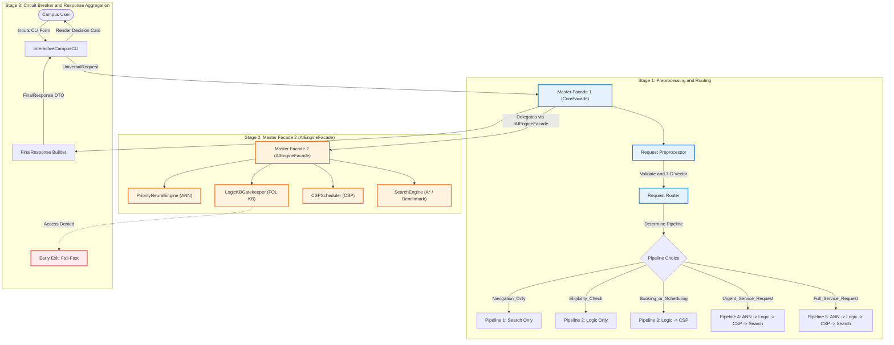
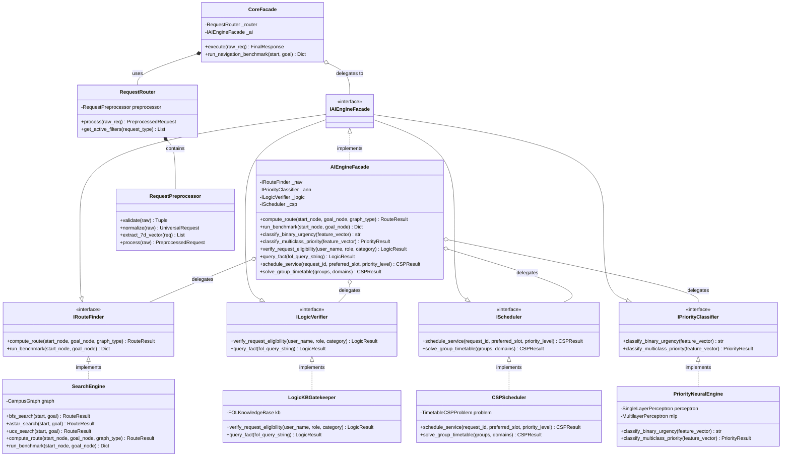
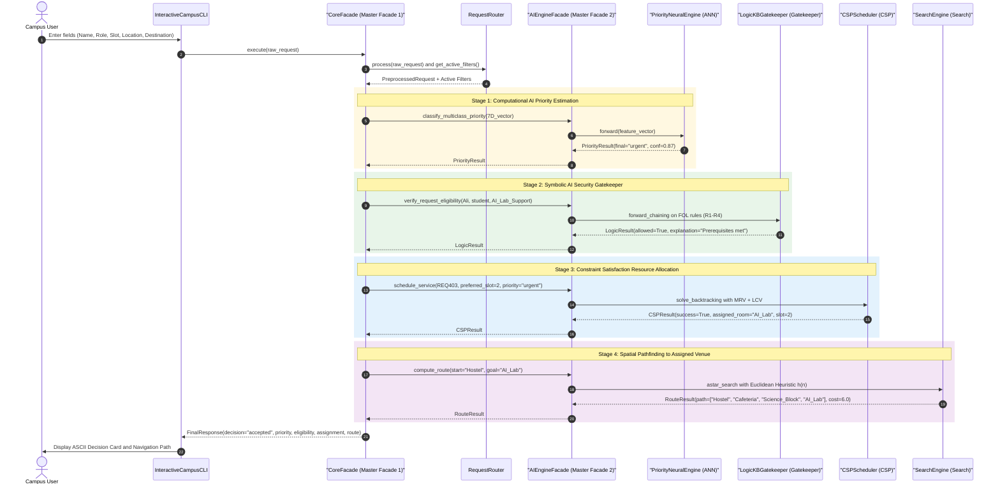
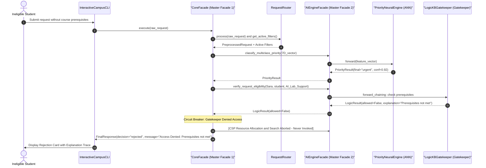
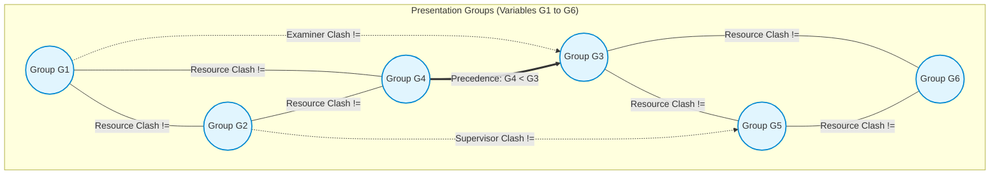
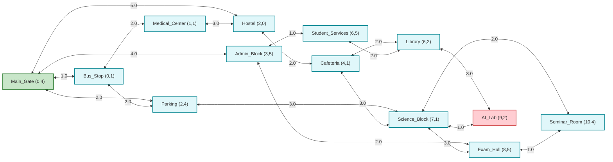

# System Architecture & Technical Design Document
## Smart Campus AI Decision Support and Automation System
**Document Type:** System Architecture & Design Specification ("HOW to Build")  
**Course:** AL2002 – Artificial Intelligence – Lab (Fall 2026)  
**Institution:** National University of Computer & Emerging Sciences (FAST-NUCES)  
**Architectural Style:** Hexagonal (Ports & Adapters) + Pipeline (Pipes & Filters)  
**Companion Document:** Aligned 100% with [`AI_PROJECT_SRS.md`](file:///C:/Users/IK/Downloads/5th_Semester_SE/Ai/Project/AI_PROJECT_SRS.md)

---

## Table of Contents
1. [Architectural Style: Hexagonal + Pipeline Engine](#1-architectural-style-hexagonal--pipeline-engine)
2. [Software Engineering Design Patterns & AI Architectural Concepts](#2-software-engineering-design-patterns--ai-architectural-concepts)
3. [SOLID Principles Application in Computational AI](#3-solid-principles-application-in-computational-ai)
4. [3-Member Independent Work Breakdown Structure (WBS)](#4-3-member-independent-work-breakdown-structure-wbs)
5. [Complete Project Folder & Package Structure](#5-complete-project-folder--package-structure)
6. [Detailed Class Names & Method Signatures (No-Code Blueprint)](#6-detailed-class-names--method-signatures-no-code-blueprint)
7. [System-Wide Mermaid UML Diagrams](#7-system-wide-mermaid-uml-diagrams)
8. [Testing Strategy, Mocking & Integration Timeline](#8-testing-strategy-mocking--integration-timeline)

---

# 1. Architectural Style: Strict 3-Tier Layered + Hexagonal Engine

The system is architected as a **strict 3-Tier Layered Architecture** with **Two Master Facades** and **Hexagonal Ports & Adapters** for zero coupling between AI mathematical algorithms and external input/output mechanisms:

```
[ LAYER 1: Presentation Layer ] (presentation/cli_view.py, main.py)
               │
               │ ◄── Boundary 1: Master Facade 1 (CoreFacade in core/core_facade.py)
               ▼
[ LAYER 2: Orchestration / BLL Layer ] (core/router.py, core/core_facade.py)
               │
               │ ◄── Boundary 2: Master Facade 2 (AIEngineFacade in ai_engines/engine_facade.py)
               ▼
[ LAYER 3: Computational AI Engines Layer ] (ai_engines/)
   ┌───────────────────────┼───────────────────────┐
   ▼                       ▼                       ▼
[ NavigationEngine ]   [ NeuralEngine ]     [ ReasoningEngine ]
(ai_engines/navigation) (ai_engines/priority) (ai_engines/reasoning)
(implements IRouteFinder) (implements IPriority) (implements ILogic & IScheduler)
```

### 1.1 The Two Master Layer Gateways (Facades)
* **Master Facade 1 (`CoreFacade` in `core/core_facade.py`):** Sits at Boundary 1 (Presentation $\leftrightarrow$ Core). The Presentation layer knows only this single class. It coordinates the 5 canonical request workflows and early-exit rejections.
* **Master Facade 2 (`AIEngineFacade` in `ai_engines/engine_facade.py`):** Sits at Boundary 2 (Core $\leftrightarrow$ AI Engines). Hides all mathematical algorithm complexity (priority queues, heuristics, weight matrices, backtracking recursion) from Layer 2.

### 1.2 Hexagonal Ports (`core/contracts.py`)
* Abstract interfaces (`IRouteFinder`, `ILogicVerifier`, `IScheduler`, `IPriorityClassifier`) define the exact contract each subsystem satisfies.
* Enables 100% isolated unit testing via test stubs (`StubRouteFinder`, `StubPriorityClassifier`).

### 1.3 Pipeline (Pipes & Filters) Pattern
* Each request moves through an ordered series of computational filters:
  $$\text{CLI Input} \to \text{Preprocessing} \to \text{Router} \to [\text{ANN Filter}] \to [\text{Gatekeeper Filter}] \to [\text{CSP Filter}] \to [\text{Search Filter}] \to \text{Response Builder}$$
* Unnecessary filters are bypassed dynamically by the Router based on the request's canonical classification.

---

# 2. Software Engineering Design Patterns & AI Architectural Concepts

### 2.1 Classical Software Engineering Patterns Applied in the System

| Pattern / Concept | Classical Software Engineering Role | Smart Campus AI Role |
| :--- | :--- | :--- |
| **Strategy Pattern** | Interchangeable algorithmic implementations behind a common interface. | Interchangeable graph pathfinding algorithms (`BFSStrategy`, `AStarStrategy`, `UCSStrategy`) and CSP variable heuristics (`MRVStrategy`, `DegreeStrategy`). |
| **Facade Pattern** | Unified gateway concealing complex internal subsystems and data structures. | `CoreFacade` (Master Facade 1) and `AIEngineFacade` (Master Facade 2) concealing algorithmic data structures and coordinating workflows. |
| **Pipes & Filters (Pipeline)** | Sequential processing of request stages with early termination capability. | 5 canonical request pipelines executing preprocessing $\to$ neural urgency $\to$ logic gate $\to$ CSP $\to$ pathfinding. |
| **Template Method** | Invariant operational lifecycle skeleton with customizable steps. | `SearchStrategy` base class enforcing the graph search skeleton (frontier loop, explored set, path reconstruction). |
| **Layered Decoupling** | Strict multi-tier separation of concerns across tiers. | CLI Presentation layer completely decoupled from computational AI engines through abstract contracts. |

### 2.2 Advanced AI Computational Concepts

| AI Architectural Concept | Theoretical Foundation | Practical Implementation in Project |
| :--- | :--- | :--- |
| **Production System / Blackboard** | Knowledge Representation & Automated Reasoning | `FOLKnowledgeBase` containing working memory facts, production rules ($R_1-R_4$), and a forward-chaining inference engine enforcing security policies. |
| **Constraint Network & CSP Engine** | NP-Complete Combinatorial Optimization | Active constraint graph where variables ($G_1-G_6$) prune domains using Backtracking + MRV + Degree + LCV + Forward Checking. |
| **Connectionist Layer Composite** | Statistical Function Approximation | Multilayer Perceptron executing linear affine transforms ($z = Wx + b$) followed by nonlinear ReLU and Softmax activation functions. |
| **Heuristic State Space Search** | State-Space Graphs & Admissible Heuristics | Evaluation function $f(n) = g(n) + h(n)$ with guaranteed Euclidean distance admissibility ($h(n) \le h^*(n)$). |

---

# 3. SOLID Principles Application in Computational AI

1. **Single Responsibility Principle (SRP):**
   * `SingleLayerPerceptron` and `MultilayerPerceptron` *only* predict urgency. They have no logic to accept or deny a user.
   * `FOLKnowledgeBase` *only* derives facts from rules. It has no awareness of campus routes.
   * `BacktrackingCSPSolver` *only* resolves resource clashes. It does not decide user priority.
   * `CampusGraph` and `SearchStrategy` *only* compute spatial paths.
2. **Open/Closed Principle (OCP):**
   * New search algorithms (e.g., Bidirectional BFS, RBFS) are added by inheriting from `SearchStrategy` without editing existing `BFSStrategy` or `AStarStrategy` code.
   * New campus landmarks or rules can be added to configuration tables without altering algorithm logic.
3. **Liskov Substitution Principle (LSP):**
   * Any search strategy implementation can be substituted into `SearchEngine` (via `IRouteFinder`) transparently without altering client execution.
4. **Interface Segregation Principle (ISP):**
   * Granular, focused ports: `IRouteFinder`, `ILogicVerifier`, `IScheduler`, `IPriorityClassifier`. Pipeline stages bind only to the specific interface they require.
5. **Dependency Inversion Principle (DIP):**
   * High-level orchestrators (`RequestRouter`, `CoreFacade`) depend entirely on abstract interfaces (`contracts.py`), never on concrete algorithm classes.

---

# 4. 3-Member Independent Work Breakdown Structure (WBS)

To ensure zero dependencies during development, work is partitioned across three roles with strict API boundaries and balanced marks (~35-45 Marks each):

```
┌────────────────────────────────────────────────────────────────────────────────────────┐
│                              3-MEMBER WORK BREAKDOWN STRUCTURE                         │
├──────────────────────────┬─────────────────────────────┬───────────────────────────────┤
│     YOU (MEMBER 1)       │          MEMBER 2           │           MEMBER 3            │
│ Architecture, Facades    │ Symbolic Logic & CSP AI     │  Neural AI & Visual GUI       │
│   & Navigation AI        │                             │         (Bonus Marks)         │
│       (45 Marks)         │        (35 Marks)           │         (35 Marks)            │
├──────────────────────────┼─────────────────────────────┼───────────────────────────────┤
│ • 3-Tier Layered Arch    │ • FOL Predicates & Rules    │ • 7-D Vector Scaling Math     │
│ • Master Facades 1 & 2   │ • Forward Chaining Engine   │ • Binary Perceptron Baseline  │
│ • Core DTOs & Contracts  │ • Security Gatekeeper logic │ • 4-Class Multiclass MLP Model│
│ • Request Preprocessor   │ • 6-Group CSP Network       │ • Softmax & ReLU Activations  │
│ • CampusGraph (13 nodes) │ • Backtracking CSP Solver   │ • Advanced Visual GUI Map     │
│ • A* Search (Euclidean)  │ • MRV, Degree, LCV, FC      │   (Tkinter Canvas window)     │
│ • 9-Algorithm Benchmark  │ • Unit Tests (Reasoning)    │ • Unit Tests (ANN & GUI)      │
│ • Basic Interactive CLI  │                             │                               │
└──────────────────────────┴─────────────────────────────┴───────────────────────────────┘
```

### Day 1 Interface Lock (Zero Blocker Guarantee)
On Day 1, Member 1 locks and commits [`core/models.py`](file:///C:/Users/IK/Downloads/5th_Semester_SE/Ai/Project/smart_campus_ai/core/models.py) and [`core/contracts.py`](file:///C:/Users/IK/Downloads/5th_Semester_SE/Ai/Project/smart_campus_ai/core/contracts.py). Members 1, 2, and 3 then code their assigned subsystems in complete isolation without merge conflicts.

---

# 5. Complete Project Folder & Package Structure (Strict 3-Tier Architecture)

```
smart_campus_ai/
│
├── main.py                             # [MEMBER 1] 5-line root entrypoint (starts the CLI)
├── requirements.txt                    # Shared dependencies (numpy, pytest)
├── README.md                           # Documentation and instructions
├── AI_PROJECT_SRS.md                   # System Requirements Specification
├── AI_PROJECT_ARCHITECTURE.md          # Full Architecture & Design Blueprint
│
├── presentation/                       # LAYER 1: PRESENTATION LAYER
│   ├── __init__.py
│   ├── cli_view.py                     # [MEMBER 1] Basic Interactive CLI Form & Menus (10 Marks)
│   └── gui_advanced.py                 # [MEMBER 3] Advanced Graphical Window with Canvas Map (15 Marks)
│
├── core/                               # LAYER 2: ORCHESTRATION / BLL LAYER (MEMBER 1)
│   ├── __init__.py
│   ├── models.py                       # [MEMBER 1] All Data Transfer Objects (DTO Dataclasses)
│   ├── contracts.py                    # [MEMBER 1] All 4 Port Interfaces (IRouteFinder, etc.)
│   ├── router.py                       # [MEMBER 1] Request Preprocessor & 7-D Vectorizer (10 Marks)
│   └── core_facade.py                  # [MEMBER 1] MASTER FACADE 1: CoreFacade (10 Marks)
│
├── ai_engines/                         # LAYER 3: COMPUTATIONAL AI ENGINES
│   ├── __init__.py
│   ├── engine_facade.py                # [MEMBER 1] MASTER FACADE 2: AIEngineFacade (Wires 3 engines)
│   │
│   ├── navigation/                     # [MEMBER 1] Spatial Graph AI Subsystem (15 Marks)
│   │   ├── __init__.py
│   │   ├── campus_graph.py             # 13 nodes, coordinates, Euclidean heuristic
│   │   └── search_engine.py            # A*, BFS, UCS, and 9-algorithm benchmark suite
│   │
│   ├── reasoning/                      # [MEMBER 2] Symbolic Logic & Constraint AI (35 Marks)
│   │   ├── __init__.py
│   │   ├── logic_kb.py                 # FOL facts, rules R1-R4, Forward Chaining Gatekeeper (20 Marks)
│   │   └── csp_scheduler.py            # 6-group viva Backtracking CSP (MRV, Degree, LCV, FC) (15 Marks)
│   │
│   └── priority_ann/                   # [MEMBER 3] Neural AI Subsystem (20 Marks)
│       ├── __init__.py
│       └── neural_engine.py            # Perceptron baseline + Multiclass MLP (ReLU/Softmax)
│
└── tests/                              # Verification Layer (Unit & Integration Tests)
    ├── __init__.py
    ├── test_navigation.py              # [MEMBER 1] Tests for graph topology and A* search
    ├── test_reasoning.py               # [MEMBER 2] Tests for logic rules and CSP scheduling
    └── test_ann_pipeline.py            # [MEMBER 3] Tests for neural models and pipeline integration
```

---

# 6. Detailed Class Names & Method Signatures (Streamlined No-Code Blueprint)

This section specifies the exact classes, attributes, constructor parameters, and method signatures required across all modules in the streamlined layout.

### 6.1 Core Contracts & Orchestration (`core/`)

```python
# File: core/contracts.py
class IRouteFinder(ABC):
    """Abstract port for spatial pathfinding and campus navigation."""

    @abstractmethod
    def compute_route(self, start_node: str, goal_node: str, graph_type: str = "weighted") -> RouteResult:
        """Computes optimal route between start and goal landmarks."""
        pass

    @abstractmethod
    def run_benchmark(self, start_node: str, goal_node: str) -> Dict[str, RouteResult]:
        """Executes all 9 curriculum search algorithms and returns comparison metrics."""
        pass

class ILogicVerifier(ABC):
    """Abstract port for symbolic reasoning and authorization verification."""

    @abstractmethod
    def verify_request_eligibility(self, user_name: str, role: str, category: str) -> LogicResult:
        """Verifies if user satisfies course prerequisites and role permissions."""
        pass

    @abstractmethod
    def query_fact(self, fol_query_string: str) -> LogicResult:
        """Evaluates arbitrary FOL query string via forward chaining."""
        pass

class IScheduler(ABC):
    """Abstract port for CSP resource and timetable allocation."""

    @abstractmethod
    def schedule_service(self, request_id: str, preferred_slot: Optional[int], priority_level: str) -> CSPResult:
        """Assigns conflict-free room and time slot for a service request."""
        pass

    @abstractmethod
    def solve_group_timetable(self, groups: List[str], domains: Dict[str, List[int]]) -> CSPResult:
        """Solves the 6-group viva examination scheduling constraint satisfaction problem."""
        pass

class IPriorityClassifier(ABC):
    """Abstract port for neural network urgency and priority prediction."""

    @abstractmethod
    def classify_binary_urgency(self, feature_vector: List[float]) -> str:
        """Evaluates 7-D vector via Perceptron returning 'urgent' or 'not_urgent'."""
        pass

    @abstractmethod
    def classify_multiclass_priority(self, feature_vector: List[float]) -> PriorityResult:
        """Evaluates 7-D vector via MLP returning operational priority and confidence."""
        pass

# File: core/router.py
class RequestPreprocessor:
    """Validates fields, normalizes casing/synonyms, and extracts the 7-D numeric vector."""

    ROLE_MAP: Dict[str, float] = {"student": 0.0, "instructor": 1.0, "staff": 2.0}
    REQUEST_TYPE_MAP: Dict[str, float] = {
        "AI_Lab_Support": 0.0, "Viva_Scheduling": 1.0,
        "Access_Request": 2.0, "Maintenance": 3.0, "Emergency_Help": 4.0
    }

    def __init__(self, known_locations: List[str]) -> None: pass
    def validate(self, raw: UniversalRequest) -> Tuple[bool, Optional[str]]: pass
    def normalize(self, raw: UniversalRequest) -> UniversalRequest: pass
    def extract_7d_vector(self, req: UniversalRequest) -> List[float]: pass
    def process(self, raw: UniversalRequest) -> PreprocessedRequest: pass

class RequestRouter:
    """Inspects request_type and determines active pipeline filters."""

    def __init__(self) -> None: pass
    def route(self, preprocessed_req: PreprocessedRequest) -> RouterDecision: pass

# File: core/core_facade.py
class CoreFacade:
    """Master Facade 1: Central orchestrator driving requests through active filter chains."""

    _router: RequestRouter
    _ai_facade: Any  # AIEngineFacade

    def __init__(self, router: RequestRouter, ai_facade: Any) -> None: pass
    def execute(self, raw_req: UniversalRequest) -> FinalResponse: pass
```

---

### 6.2 Member 1: Spatial Graph AI Subsystem (`navigation/`)

```python
# File: navigation/campus_graph.py
class CampusGraph:
    """Stores 13 campus landmarks, coordinates, and 19 weighted/unweighted edges."""

    NODES: Dict[str, Tuple[float, float]] = {
        "Main_Gate": (0.0, 4.0), "Bus_Stop": (0.0, 1.0), "Medical_Center": (1.0, 1.0),
        "Hostel": (2.0, 0.0), "Parking": (2.0, 4.0), "Admin_Block": (3.0, 5.0),
        "Cafeteria": (4.0, 1.0), "Student_Services": (6.0, 5.0), "Library": (6.0, 2.0),
        "Science_Block": (7.0, 1.0), "Exam_Hall": (8.0, 5.0), "AI_Lab": (9.0, 2.0),
        "Seminar_Room": (10.0, 4.0)
    }

    def __init__(self) -> None: pass
    def get_coordinates(self, node_name: str) -> Tuple[float, float]: pass
    def get_neighbors(self, node_name: str, weighted: bool = True) -> List[Any]: pass
    def is_valid_node(self, node_name: str) -> bool: pass
    @staticmethod
    def euclidean_heuristic(a_coords: Tuple[float, float], b_coords: Tuple[float, float]) -> float: pass

# File: navigation/search_engine.py
class SearchNode:
    """Represents a node in the search tree with path cost and heuristic."""
    state: str
    parent: Optional['SearchNode']
    action: Optional[str]
    path_cost: float
    depth: int
    heuristic_cost: float

    def __init__(self, state: str, parent: Optional['SearchNode'] = None,
                 path_cost: float = 0.0, heuristic_cost: float = 0.0) -> None: ...
    @property
    def total_cost(self) -> float: ...
    def __lt__(self, other: 'SearchNode') -> bool: ...

class SearchEngine(IRouteFinder):
    """Implements BFS, A* (Euclidean), UCS, and the 9-algorithm benchmark suite."""

    def __init__(self, graph: CampusGraph) -> None: pass
    def bfs_search(self, start: str, goal: str) -> RouteResult: pass
    def astar_search(self, start: str, goal: str) -> RouteResult: pass
    def ucs_search(self, start: str, goal: str) -> RouteResult: pass
    def dfs_search(self, start: str, goal: str) -> RouteResult: pass
    def dls_search(self, start: str, goal: str, limit: int) -> RouteResult: pass
    def ids_search(self, start: str, goal: str, max_depth: int = 15) -> RouteResult: pass
    def bidirectional_bfs(self, start: str, goal: str) -> RouteResult: pass
    def greedy_best_first(self, start: str, goal: str) -> RouteResult: pass
    def rbfs_search(self, start: str, goal: str) -> RouteResult: pass
    def compute_route(self, start_node: str, goal_node: str, graph_type: str = "weighted") -> RouteResult: pass
    def run_benchmark(self, start_node: str, goal_node: str) -> Dict[str, RouteResult]: pass
    def render_markdown_table(self, results: Dict[str, RouteResult]) -> str: pass
```

---

### 6.3 Member 2: Symbolic Reasoning & Constraint AI Subsystem (`reasoning/`)

```python
# File: reasoning/logic_kb.py
class FOLPredicate:
    """Represents a first-order logic atom PredicateName(arg1, arg2, ...)."""
    name: str
    args: Tuple[str, ...]

    def __init__(self, name: str, *args: str) -> None: pass
    def is_ground(self) -> bool: pass
    def substitute(self, bindings: Dict[str, str]) -> 'FOLPredicate': pass
    def __eq__(self, other: Any) -> bool: pass
    def __hash__(self) -> int: pass

class FOLRule:
    """Represents an implication rule: Antecedents => Consequent."""
    antecedents: List[FOLPredicate]
    consequent: FOLPredicate

    def __init__(self, antecedents: List[FOLPredicate], consequent: FOLPredicate) -> None: pass

class LogicKBGatekeeper(ILogicVerifier):
    """FOL Knowledge Base with Forward Chaining inference acting as Security Gatekeeper."""

    def __init__(self) -> None: pass
    def load_default_campus_rules(self) -> None: pass
    def tell_fact(self, fact: FOLPredicate) -> None: pass
    def tell_rule(self, rule: FOLRule) -> None: pass
    def forward_chain(self, query: FOLPredicate) -> Tuple[bool, List[str]]: pass
    def verify_request_eligibility(self, user_name: str, role: str, category: str) -> LogicResult: pass
    def query_fact(self, fol_query_string: str) -> LogicResult: pass

# File: reasoning/csp_scheduler.py
class TimetableCSPProblem:
    """Formulates variables, domains, and hard constraints for 6-group viva scheduling."""
    variables: List[str]                  # ["G1", "G2", "G3", "G4", "G5", "G6"]
    domains: Dict[str, List[int]]         # Slot options e.g. [1, 2, 3, 4]
    clash_pairs: List[Tuple[str, str]]    # Resource & room conflicts
    examiner_clash: Tuple[str, str]       # ("G1", "G3")
    supervisor_clash: Tuple[str, str]     # ("G2", "G5")
    precedence_constraint: Tuple[str, str]# ("G4", "G3") -> G4 < G3

    def __init__(self) -> None: pass
    def is_consistent(self, var: str, val: int, current_assignment: Dict[str, int]) -> bool: pass

class CSPScheduler(IScheduler):
    """Backtracking solver with MRV, Degree, LCV, and Forward Checking."""

    def __init__(self, problem: Optional[TimetableCSPProblem] = None) -> None: pass
    def select_unassigned_variable_mrv_degree(self, assignment: Dict[str, int], domains: Dict[str, List[int]]) -> str: pass
    def order_domain_values_lcv(self, var: str, domains: Dict[str, List[int]]) -> List[int]: pass
    def forward_check(self, var: str, val: int, domains: Dict[str, List[int]]) -> Optional[Dict[str, List[int]]]: pass
    def solve_backtracking(self) -> Optional[Dict[str, int]]: pass
    def schedule_service(self, request_id: str, preferred_slot: Optional[int], priority_level: str) -> CSPResult: pass
    def solve_group_timetable(self, groups: List[str], domains: Dict[str, List[int]]) -> CSPResult: pass
```

---

### 6.4 Member 3: Neural Priority Prediction Subsystem (`priority_ann/`)

```python
# File: priority_ann/neural_engine.py
class SingleLayerPerceptron:
    """Single-layer binary urgency baseline classifier."""
    weights: List[float]
    bias: float

    def __init__(self, input_dim: int = 7) -> None: pass
    def step_function(self, z: float) -> int: pass
    def predict(self, feature_vector: List[float]) -> str: pass

class MultilayerPerceptron:
    """7 -> 4 -> 3 -> 4 Multiclass MLP with ReLU and Softmax activations."""
    CLASSES: List[str] = ["low", "normal", "high", "urgent"]

    def __init__(self) -> None: pass
    def relu(self, z: Any) -> Any: pass
    def softmax(self, z: Any) -> Any: pass
    def forward(self, feature_vector: List[float]) -> Tuple[str, float, Dict[str, float]]: pass

class PriorityNeuralEngine(IPriorityClassifier):
    """Coordinates Perceptron and MLP predictions with synthetic sample generation."""

    _perceptron: SingleLayerPerceptron
    _mlp: MultilayerPerceptron

    def __init__(self) -> None: pass
    def generate_synthetic_samples(self, count: int = 200) -> List[Tuple[List[float], str, int]]: pass
    def classify_binary_urgency(self, feature_vector: List[float]) -> str: pass
    def classify_multiclass_priority(self, feature_vector: List[float]) -> PriorityResult: pass
```

---

### 6.5 Main CLI & Scenario Runner (`main.py`)

```python
# File: presentation/cli_view.py
class InteractiveCampusCLI:
    """Master terminal application providing interactive prompts and pre-set test scenarios."""

    def __init__(self, core_facade: CoreFacade) -> None: pass
    def prompt_user_request(self) -> UniversalRequest: pass
    def render_console_response(self, response: FinalResponse) -> None: pass
    def run_scenario_suite(self) -> None: pass
    def start(self) -> None: pass
```

---

# 7. System-Wide Mermaid UML Diagrams

### 7.1 Master System Architecture Flow Diagram


---

### 7.2 Comprehensive UML Class Diagram


---

### 7.3 Sequence Diagram: `Full_Service_Request` End-to-End


---

### 7.4 Sequence Diagram: Gatekeeper Rejection Handling


---

### 7.5 CSP Timetable Presentation Constraint Network


---

### 7.6 Campus Map Navigation Topology


---

# 8. Testing Strategy, Mocking & Integration Timeline

### 8.1 Zero-Blocker Testing with Stubs
On Day 1, each student implements local mock stubs or utilizes the built-in fallbacks in `AIEngineFacade`:

```python
# Example stub used by Member 1 to test CoreFacade before engines are integrated:
class MockRouteFinder(IRouteFinder):
    def compute_route(self, start_node: str, goal_node: str, graph_type: str = "weighted") -> RouteResult:
        return RouteResult(algorithm_used="A*", path=[start_node, goal_node], cost=5.0, steps=1)

    def run_benchmark(self, start_node: str, goal_node: str) -> Dict[str, RouteResult]:
        return {}
```

### 8.2 6-Day Development Timeline

| Day | Milestone | Responsible | Key Deliverable |
| :---: | :--- | :---: | :--- |
| **Day 1** | **Contract Lock & Stubs** | All Members | Finalize `core/models.py`, `core/contracts.py`, and `ai_engines/engine_facade.py` stubs. |
| **Day 2–3** | **Isolated Subsystem Coding** | Individual | Member 1 builds Graph, Search, Master Facades, and Preprocessor.<br>Member 2 builds FOL KB, Gatekeeper, and Backtracking CSP.<br>Member 3 builds Perceptron, Multiclass MLP, and Visual GUI. |
| **Day 4** | **Independent Unit Testing** | Individual | Run `pytest tests/test_navigation.py`, `tests/test_reasoning.py`, and `tests/test_ann_pipeline.py`. |
| **Day 5** | **Assembly & Pipeline Integration** | Member 1 + All | Wire concrete AI engines into `AIEngineFacade` and `CoreFacade`. Run end-to-end scenario suite. |
| **Day 6** | **CLI Verification & Report** | All Members | Capture screenshots across all 5 pipelines, gatekeeper rejection, and benchmark runs for Word report. |
